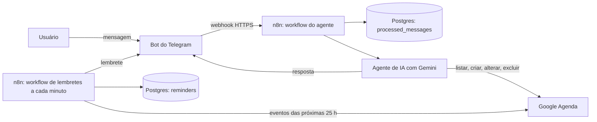

# Genius Agenda AI

Assistente pessoal que gerencia compromissos no Google Agenda por linguagem natural, com lembretes automáticos. Construído com n8n, Postgres, Docker e Gemini.

## Status

| Item | Situação |
|---|---|
| Criar, consultar, alterar e excluir eventos por conversa | Funcionando |
| Resumos de agenda (dia, semana, mês) | Funcionando, via consulta por período |
| Lembretes automáticos (24 h, 1 h e 15 min antes) | Funcionando, com reconciliação |
| Idempotência de mensagens | Funcionando |
| Canal de conversa | Telegram (temporário) |
| WhatsApp (API oficial da Meta) | Pendente: o SMS de verificação da conta de desenvolvedor da Meta não chegou |
| Briefings e cards com imagem gerada por IA | Não implementado |

O briefing prevê o WhatsApp como canal. Como a verificação da conta da Meta ficou bloqueada, o Telegram foi usado como alternativa gratuita, conforme a regra de alternativas documentadas. A entrada no formato do webhook da Meta está pronta em `workflows/01_entrada_whatsapp.json`, e a troca de canal fica restrita aos nós de entrada e de saída.

## Arquitetura



- **Agente (`workflows/02_agente_telegram.json`)**: recebe a mensagem, registra o ID para evitar duplicidade, passa o texto ao agente de IA e responde. O agente usa quatro ferramentas do Google Agenda e só confirma uma ação depois do retorno da API. Em caso de falha, o usuário recebe um aviso de que o resultado não foi confirmado.
- **Lembretes (`workflows/04_lembretes.json`)**: a cada minuto sincroniza os eventos das próximas 25 horas com a tabela `reminders`, cancela lembretes de eventos removidos, atualiza os de eventos que mudaram de horário e envia os que venceram. Os lembretes não dependem de o usuário enviar mensagem.
- **Prompt do agente**: `prompts/agente_sistema.md`.

## Estrutura

- `docker-compose.yml`: Postgres e n8n.
- `sql/001_init.sql`: tabelas do projeto.
- `workflows/`: workflows do n8n exportados, sem credenciais.
- `prompts/agente_sistema.md`: instruções do agente.
- `tests/`: testes automatizados e payloads de exemplo.
- `.env.example`: variáveis de ambiente, sem valores reais.

## Como rodar

1. Copie `.env.example` para `.env` e preencha os valores.
2. Suba os containers:
   ```
   docker compose up -d
   ```
3. Crie as tabelas:
   ```
   docker compose cp sql/001_init.sql db:/tmp/001_init.sql
   docker compose exec db psql -U <DB_USER> -d <DB_NAME> -f /tmp/001_init.sql
   ```
4. Exponha o n8n com um túnel HTTPS (por exemplo, ngrok), coloque a URL em `WEBHOOK_URL` no `.env` e recrie o n8n:
   ```
   docker compose up -d --force-recreate n8n
   ```
5. Abra `http://localhost:5678`, crie a conta de dono e importe os arquivos de `workflows/`.
6. Crie as credenciais no n8n: Postgres (host `db`), Google Calendar (OAuth2), Telegram (token do @BotFather) e Google Gemini (chave do Google AI Studio).
7. Publique os workflows e converse com o bot.

## Testes

Os testes automatizados rodam contra o Postgres do projeto, dentro de uma transação que é desfeita no final, sem alterar dados reais:

```
powershell -File tests/run_tests.ps1
```

Cobrem: mensagem duplicada, criação de lembretes sem horários no passado, sincronização repetida sem duplicar, lembrete já enviado não reenviado, mudança de horário atualizando o alerta e exclusão de evento cancelando lembretes pendentes. A consulta de sincronização usada no teste é a mesma do nó "Sincronizar lembretes" e precisa ser mantida em conjunto.

## Cenários do briefing

| Cenário | Como é tratado |
|---|---|
| "Marca uma reunião amanhã à tarde" | O prompt obriga a perguntar o horário exato |
| Duas reuniões com o mesmo cliente | O prompt obriga a listar as opções e pedir a escolha |
| Evento excluído | Os lembretes pendentes passam a `cancelled` (teste automatizado) |
| API do Google falha | O ramo de erro avisa que o resultado não foi confirmado |
| Mesmo webhook duas vezes | Tabela `processed_messages` com chave única (teste automatizado) |
| Agenda do mês | O agente consulta eventos reais por período |
| Evento muda de horário | O lembrete é atualizado e volta a pendente (teste automatizado) |
| Falha na geração da imagem | Não se aplica: briefings com imagem não foram implementados |

## Segurança

- Tokens, senhas e chaves ficam no `.env` e nas credenciais do n8n. O `.env` está no `.gitignore`.
- O repositório usa apenas dados fictícios e um calendário de teste.
- O agente só tem acesso às quatro operações de evento do Google Agenda.

## Limitações conhecidas e melhorias futuras

- WhatsApp real pendente da verificação da conta da Meta.
- Uso por um único usuário e um único calendário.
- A memória da conversa fica em memória do n8n e se perde ao reiniciar.
- Lembretes verificados a cada minuto (a precisão é de cerca de 1 minuto), com janela de 25 horas: o lembrete de 24 h só é criado quando o evento entra nessa janela.
- Eventos de dia inteiro não geram lembretes.
- O modelo gratuito do Gemini pode retornar erro 503 em picos de demanda, e o agente tenta de novo automaticamente.
- Sem testes de ponta a ponta com o Telegram e o Google Agenda reais.
- Melhorias: troca para o WhatsApp, detecção de conflitos e sugestões de reagendamento, briefings e cards visuais com imagem gerada por IA, suporte a vários usuários.
